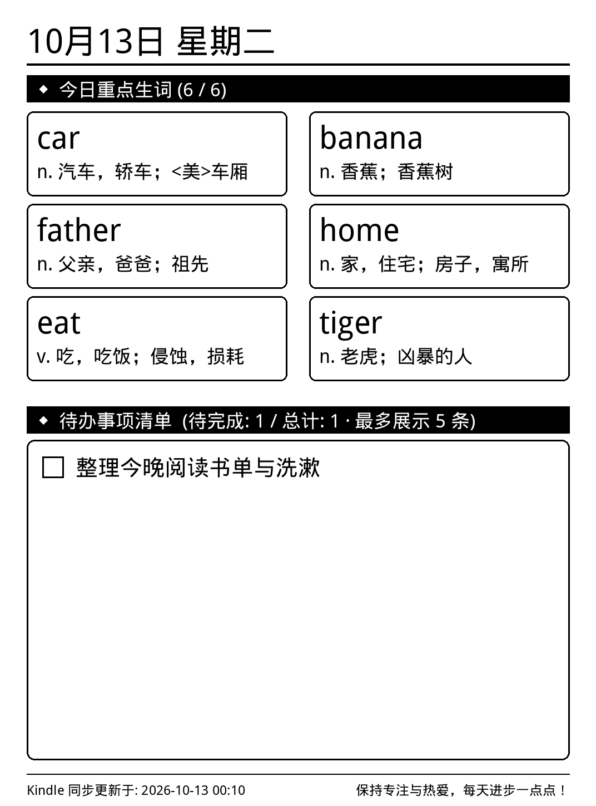
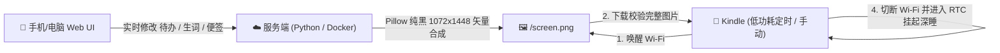

# 📖 Kindle 同步看板 (Kindle-Board)

> **让闲置 Kindle 变身实用低功耗桌面/镜前墨水屏看板。**  
> 手机端随时随地同步待办事项、每日重点生词与便签，墨水屏优雅常显，充一次电稳定续航 2～3 周！

<p align="center">
  <b>简体中文</b> | <b><a href="README_EN.md">English</a></b>
</p>

<p align="center">
  
</p>

<p align="center">
  
  
  
  
</p>

---

## ✨ 核心特性

- ⚡ **超低功耗硬件深度休眠（2～3 周真长续航）**  
  区别于市面上“开着 Wi-Fi 一天就耗尽电量”的方案，本项目在刷新完成后**立即切断 Wi-Fi**，并通过 Linux RTC 闹钟将整机推入挂起休眠（`echo mem > /sys/power/state`）。电子墨水断电常驻，整机微安级功耗，无须持续连线。
- 📱 **响应式移动端 Web 管理后台**  
  无需安装任何客户端 App，手机或电脑浏览器直接打开管理面板。随时划掉已办事项、添加待办、录入生词并自动调取词典提炼释义。
- 🔤 **专为 1～2 米远距离视距定制**  
  针对洗漱台、梳妆镜前或书桌远端视距，采用双列超大字号排版（英文 56px 加粗 / 中文 34px），字迹醒目大气，一眼即清。
- 🎨 **100% 纯黑墨水屏高对比度（拒绝“掉色”发虚）**  
  彻底摒弃在墨水屏上会呈现为“半透明/铅笔擦痕”的灰度字体，全文字与卡片均采用 100% 纯黑色阶（#000000），微胶囊物理颗粒完全吸附，质感如同激光印刷。
- 🛡️ **原子化安全刷新与防连击锁**  
  加入并发互斥锁（`dashboard_once.lock`），并严格校验新图片完整性（>10KB）后才执行清屏，彻底杜绝手滑连击导致的“白屏”问题。
- 🔄 **双模式全覆盖（越狱版 / 免越狱版）**  
  - **越狱进阶模式**：配合 KUAL 扩展插件，单次按需刷新或定时低功耗常驻；
  - **免越狱小白模式**：接通电源线，打开 Kindle 自带的“体验版网页浏览器”访问 `/view` 页面，全屏自动静默刷新。

---

## 🛠️ 架构流程



---

## 🚀 服务端快速部署

服务端极其轻量（纯 Python + Pillow，内存占用 < 10MB），支持多种部署方式。

### 方式一：Docker 一键部署（推荐）

```bash
git clone https://github.com/baoyiuon/Kindle-Board.git
cd Kindle-Board/docker

# 启动容器（默认映射端口 8085，数据持久化保存在 ./data 目录）
docker compose up -d
```

### 方式二：Python 直接运行

```bash
git clone https://github.com/baoyiuon/Kindle-Board.git
cd Kindle-Board

# 安装字体依赖（Linux 环境需安装文泉驿中文字体与 DejaVu 国际音标矢量字体）
sudo apt update && sudo apt install -y fonts-wqy-microhei fonts-dejavu-core

# 安装 Python 依赖并启动
pip install -r server/requirements.txt
python3 server/server.py 8085
```

访问 `http://你的服务器IP:8085/` 即可进入手机管理面板！

---

## 📖 Kindle 客户端配置

### 1. 越狱模式（推荐，实现长续航）

**前置要求**：Kindle 已越狱并安装了 **KUAL**（支持各主流越狱方案如 LanguageBreak / WinterBreak / WatchThis）。

1. 将 Kindle 通过 USB 数据线连接到电脑；
2. 将本项目 `client/` 目录下的内容完整拷贝到 Kindle 存储根目录：
   - 将 `client/dashboard.sh` 复制到 Kindle 根目录（`/mnt/us/dashboard.sh`）；
   - 将 `client/extensions/kindle_dashboard` 复制到 Kindle 的 `extensions/` 目录下；
3. 打开 Kindle 根目录下的 `dashboard.sh`，将其中的 `SERVER_URL` 修改为你部署的服务端地址：
   ```sh
   SERVER_URL="http://你的服务器IP:8085/screen.png"
   ```
4. 安全弹出并断开 USB 连接，打开 Kindle 图书馆中的 **KUAL**：
   - 点击 **【Kindle同步看板】** -> **【立即刷新一次看板】**，即可秒级拉取最新画面！
   - 点击 **【启动定时自动看板 (低功耗)】**，设备将全自动在后台定时唤醒并休眠。

### 2. 免越狱模式（零门槛）

如果设备未越狱：
1. 让 Kindle 保持连接 Wi-Fi，并插上电源线；
2. 点击 Kindle 右上角菜单 -> **体验版网页浏览器**；
3. 在地址栏直接输入：
   ```text
   http://你的服务器IP:8085/view
   ```
4. 页面将全屏显示看板图片，并每 60 秒自动检查并无缝刷新。

---

## 📱 适配设备与分辨率参考

| Kindle 设备型号 | 屏幕分辨率 | 适配状态 | 备注 |
| :--- | :--- | :---: | :--- |
| **Kindle Paperwhite 3 (KPW3)** | 1072 × 1448 (300 PPI) | 完美原生支持 | 最佳测试基准机型 |
| **Kindle Paperwhite 4 (KPW4)** | 1072 × 1448 (300 PPI) | 完美原生支持 | 300 PPI 高清灰阶 |
| **Kindle Voyage (KV)** | 1072 × 1448 (300 PPI) | 完美原生支持 | 压感按键经典款 |
| **Kindle Oasis 1/2/3** | 1072 × 1448 / 等效 | 完美原生支持 | 屏幕显示效果极佳 |
| **Kindle 11 代 (基础版)** | 1072 × 1448 (300 PPI) | 完美原生支持 | 新一代基础款 |
| **Kindle Paperwhite 5 (KPW5)** | 1236 × 1648 (300 PPI) | 原生居中/自适应 | 6.8 寸大屏 |
| **Kindle 8 / 10 代 (青春版)** | 800 × 600 (167 PPI) | 自动缩放支持 | 基础款分辨率兼容 |

---

## ❓ 常见问题 (FAQ)

<details>
<summary><b>Q: 为什么刷新时屏幕会闪一下？</b></summary>
这是电子墨水屏（E-ink）的物理清屏特性（GC16 全局波形重置），用于消除上一帧画面的墨水残影，确保最新字迹对比度达到最高。
</details>

<details>
<summary><b>Q: 点击「启动定时自动看板」后为什么触屏不响应？</b></summary>
自动模式为了实现几周的超长续航，刷新完成后立刻让 CPU 和触屏芯片进入了底层硬件挂起休眠（以省下微安级电量）。短按一下机身底部的【电源物理键】即可物理中断唤醒；或通过 KUAL 菜单点击【停止定时自动看板】退回纯手动刷新模式。
</details>

<details>
<summary><b>Q: 为什么音标或某些符号显示为方块？</b></summary>
若自行在服务器部署，请确保 Linux 系统安装了支持全量国际音标的 `fonts-dejavu-core` 矢量字体包（Docker 镜像中已默认内置，无需手动配置）。
</details>

---

## 📄 开源许可证

本项目基于 [MIT License](LICENSE) 开源。欢迎提 Issue、PR 或分享你改造的个性化看板！