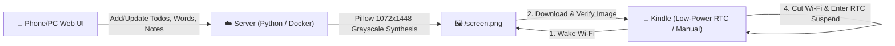

# 📖 Kindle-Board

> **Transform your retired Kindle into an ultra-low-power E-ink sync dashboard.**  
> Real-time mobile sync for daily to-dos, vocabulary flashcards, and custom memos. Elegant always-on E-ink display with **2–3 weeks of battery life** on a single charge!

<p align="center">
  <b><a href="README.md">简体中文</a></b> | <b>English</b>
</p>

<p align="center">
  
</p>

<p align="center">
  
  
  
  
</p>

---

## ✨ Key Features

- ⚡ **Ultra-Low-Power Hardware Deep Sleep (2–3 Weeks Battery Life)**  
  Unlike typical DIY dashboard projects that drain the battery in 24 hours by keeping Wi-Fi constantly active, **Kindle-Board powers down the Wi-Fi chip immediately after fetching the screen image** and triggers Linux RTC hardware suspend (`echo mem > /sys/power/state`). The microampere standby current allows you to place it anywhere cable-free for weeks.
- 📱 **Responsive Mobile Web Portal**  
  No companion app required. Access the intuitive web control panel from any mobile or desktop browser. Check off completed items, add new tasks, or enter vocabulary words with automated dictionary definitions.
- 🔤 **Optimized for Distance Viewing (1–2 Meters)**  
  Engineered specifically for viewing from a distance (bathroom mirror, dressing table, or bedside desk). Features high-legibility two-column card layout with large **56px bold typography** and concise translations.
- 🎨 **100% Jet-Black E-Ink Contrast (Zero Fading or Washed-Out Grays)**  
  Eliminates the "faded pencil" look caused by half-tone gray shades on E-ink screens. All text and borders are rendered in pure black (`#000000`), utilizing maximum physical microcapsule particle attraction for laser-printer sharpness.
- 🛡️ **Atomic Safe Refresh & Anti-DoubleClick Lock**  
  Features concurrency locking (`dashboard_once.lock`) and strictly verifies file integrity (>10KB) before triggering screen clear. Even with rapid tapping or unstable Wi-Fi, the screen will **never turn blank or white**.
- 🔄 **Dual Mode Support (Jailbroken & Non-Jailbroken)**  
  - **Jailbreak Low-Power Mode**: Native KUAL launcher extension with background RTC deep sleep daemon;
  - **No-Jailbreak Web Mode**: Plug into power and open the Kindle Experimental Web Browser to `/view` for automated, full-screen silent refreshes.

---

## 🛠️ Architecture Workflow



---

## 🚀 Server Deployment

The server is extremely lightweight (Pure Python + Pillow, memory footprint < 10MB) and runs on any minimal VPS, Raspberry Pi, or home NAS.

### Method 1: Docker (Recommended)

```bash
git clone https://github.com/baoyiuon/Kindle-Board.git
cd Kindle-Board/docker

# Start container (Default port: 8085, persistent data in ./data)
docker compose up -d
```

### Method 2: Native Python

```bash
git clone https://github.com/baoyiuon/Kindle-Board.git
cd Kindle-Board

# Install font dependencies (Debian/Ubuntu: MicroHei Chinese + DejaVu IPA fonts)
sudo apt update && sudo apt install -y fonts-wqy-microhei fonts-dejavu-core

# Install Python requirements and start
pip install -r server/requirements.txt
python3 server/server.py 8085
```

Open `http://your-server-ip:8085/` in your browser to access the management portal!

---

## 📖 Kindle Client Setup

### 1. Jailbroken Mode (Recommended for Long Battery Life)

**Prerequisites**: Your Kindle is jailbroken and has **KUAL** installed (compatible with LanguageBreak, WinterBreak, WatchThis, etc.).

1. Connect your Kindle to your PC via USB cable;
2. Copy the files from the `client/` directory to your Kindle root storage:
   - Copy `client/dashboard.sh` to Kindle root (`/mnt/us/dashboard.sh`);
   - Copy `client/extensions/kindle_dashboard` into Kindle's `extensions/` directory;
3. Open `dashboard.sh` on your Kindle and update `SERVER_URL` to your server address:
   ```sh
   SERVER_URL="http://your-server-ip:8085/screen.png"
   ```
4. Safely eject USB. Open **KUAL** on your Kindle:
   - Tap **【Kindle同步看板】** -> **【立即刷新一次看板】** to fetch and render the latest board on demand!
   - Tap **【启动定时自动看板 (低功耗)】** to start the automatic low-power background loop.

### 2. Non-Jailbroken Mode (Zero Setup)

If your Kindle is not jailbroken or cannot be jailbroken on newer firmware:
1. Connect Kindle to Wi-Fi and plug into a power cable;
2. Open the top-right menu -> **Experimental Web Browser**;
3. Enter your server view address:
   ```text
   http://your-server-ip:8085/view
   ```
4. The screen will render full-screen and automatically check and refresh every 60 seconds.

---

## 📱 Hardware & Resolution Compatibility

| Kindle Model | Resolution | Compatibility | Notes |
| :--- | :--- | :---: | :--- |
| **Kindle Paperwhite 3 (KPW3)** | 1072 × 1448 (300 PPI) | Native Supported | Primary reference device |
| **Kindle Paperwhite 4 (KPW4)** | 1072 × 1448 (300 PPI) | Native Supported | 300 PPI Carta HD |
| **Kindle Voyage (KV)** | 1072 × 1448 (300 PPI) | Native Supported | Classic haptic buttons |
| **Kindle Oasis 1/2/3** | 1072 × 1448 / Equivalent | Native Supported | High contrast screen |
| **Kindle 11th Gen (Basic)** | 1072 × 1448 (300 PPI) | Native Supported | Modern basic model |
| **Kindle Paperwhite 5 (KPW5)** | 1236 × 1648 (300 PPI) | Auto-Centered | 6.8" large screen |
| **Kindle 8th / 10th Gen** | 800 × 600 (167 PPI) | Auto-Scaled | Low-resolution models |

---

## ❓ Frequently Asked Questions (FAQ)

<details>
<summary><b>Q: Why does the screen flash when refreshing?</b></summary>
This is the physical characteristic of E-ink technology (GC16 global waveform reset). It eliminates ghosting from the previous frame and restores maximum pigment contrast.
</details>

<details>
<summary><b>Q: Why does touchscreen become unresponsive in automatic daemon mode?</b></summary>
To achieve 2–3 weeks of battery life, the daemon cuts power to CPU and touch sensors immediately after refreshing. Press the physical **Power Button** once to wake the device, or use KUAL to stop the daemon and revert to on-demand manual refresh mode.
</details>

<details>
<summary><b>Q: Why do phonetic symbols or icons show as square boxes (tofu)?</b></summary>
If hosting on your own server, ensure `fonts-dejavu-core` is installed on your Linux system (already bundled in the Docker image).
</details>

---

## 📄 License

This project is licensed under the [MIT License](LICENSE).